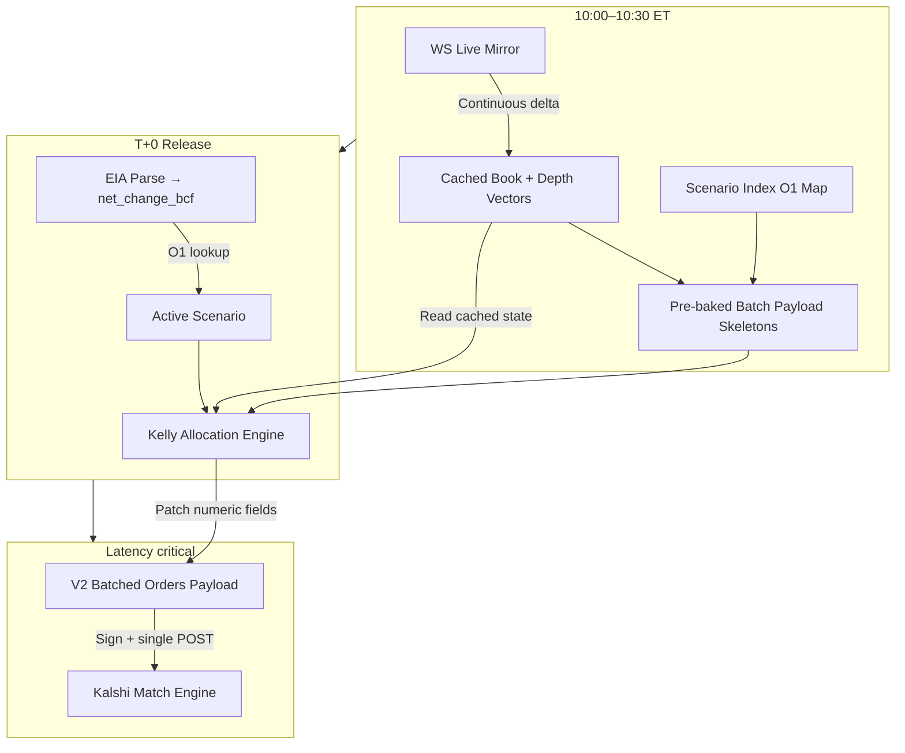

# PRD: Multi-Leg Execution

**Status:** Draft (v3 — execution hardening pass)  
**Author:** NullOne team  
**Last updated:** 2026-05-23

---

## 1. Overview

### 1.1 Problem

NullOne today executes a **single IOC YES bid** on the winning EIA gas storage bracket after the WNGSR release. This leaves potential edge on the table:

- **Loser NO** books may remain mispriced briefly after the print.
- **Fixed notional** ignores depth, fill likelihood, and per-leg edge.
- **Single POST** underuses Kalshi's batch API and splits capital inefficiently across complementary legs.
- **Post-release assembly** (map → risk → build order) adds avoidable latency.

### 1.2 Proposal

Extend the release pipeline to:

1. Trade **YES on the winner** and **NO on losers** (economic exposure via Kalshi V2 YES-book semantics).
2. Submit all approved legs in a **single batched V2 HTTP POST**.
3. Use **precomputed scenario indexes** for O(1) lookup at release.
4. Maintain **live book vectors** during warmup (updated on every WS delta).
5. Allocate a **fixed capital budget C** across legs using a **parse-error-aware multi-leg Kelly allocator** to maximize edge capture under a shared bankroll.

### 1.3 Economic model (why multi-leg)

After EIA, **one bracket wins** (the range containing the print). If parse/map is **correct**, the optimal portfolio is **complementary**, not competing:

| Leg | Settles at $1 when parse is correct |
|-----|-------------------------------------|
| YES on winner | Yes |
| NO on each loser | Yes (those ranges did not occur) |

All approved legs can win **simultaneously**. The allocation problem is: given fixed **C**, how much to deploy on each bracket-leg based on **entry price, payout ratio, parse-error risk, and fill depth** — not "which bracket wins."

### 1.4 Success metrics

| Metric | Target |
|--------|--------|
| Batch order latency | `t_order_ms` ≈ single HTTP round trip regardless of leg count |
| Paper validation | 3+ clean multi-leg paper releases with full per-leg telemetry |
| Fill-adjusted edge | Multi-leg ≥ single-leg over 4+ releases (paper or small live) |
| Regression | Single-leg path remains available via feature flag |

---

## 2. Current System

### 2.1 Release flow

```
systemd timer (Thu 10:00 ET)
  → resolve spec (Kalshi tickers)
  → warm Kalshi WebSocket on all bracket tickers
  → warm Kalshi HTTP order client
  → EIA baseline fetch
  → sleep until ~15s before 10:30 ET
  → race EIA JSON + CSV
  → parse net change (Bcf)
  → BracketMapper → single winning bracket
  → risk gate (winner YES book only)
  → one Kalshi IOC (side: bid = buy YES)
  → optional one Polymarket order
  → JSON log
```

### 2.2 Warmup today

| Component | When | Purpose |
|-----------|------|---------|
| `KalshiOrderBookMirror` | Before sleep | WS `orderbook_delta` for every spec ticker |
| `KalshiOrderClient` | Before sleep | HTTP client + RSA key loaded |
| `WNGSRPoller` | Before sleep | EIA connection + baseline fetch |
| Order payloads | Not pre-built | Assembled after parse + risk |
| Multi-bracket execution | No | Winner YES only |
| Cached best bid/ask vectors | No | Full book rebuilt on `snapshot()` |

### 2.3 Order semantics today

- **Venue:** Kalshi (primary); Polymarket optional
- **Endpoint:** `POST /portfolio/events/orders` (V2 single order)
- **Kalshi:** one `side: "bid"` (buy YES) on winning ticker
- **Size:** fixed `NULLONE_RELEASE_CAPITAL_USD` / `execution.release_capital_usd`
- **Type:** `immediate_or_cancel` (IOC)
- **Risk:** one pass/fail on best ask vs `min_edge_after_fees`, `max_entry_price`
- **NO legs:** not used

### 2.4 Book model

Each bracket is a separate binary market. WS mirror tracks YES and NO bids; YES asks are implied:

```
ask_yes ≈ 1 − best_bid_no
ask_no  ≈ 1 − best_bid_yes   (symmetric implication)
```

**Code:** `nullone/exchanges/kalshi/ws_book.py`, `nullone/engine/pipeline.py`, `nullone/exchanges/kalshi/orders.py`, `nullone/engine/risk.py`.

### 2.5 Known limitations

1. Edge only on **winning YES**; loser NO ignored.
2. **One IOC** — no book walk or partial-fill follow-up.
3. **Fixed notional** — no capital allocation across complementary legs.
4. **Single Kalshi POST** per release.
5. Map/risk/order build runs entirely **after** EIA parse.

---

## 3. Proposed System

### 3.1 Goals

| # | Goal |
|---|------|
| G1 | **Winner YES** + **loser NO** legs after net change is known |
| G2 | **Single batched V2 POST** for all approved legs |
| G3 | **Precomputed scenario indexes** (O(1) lookup) + order templates |
| G4 | **Live book vectors** updated continuously during warmup |
| G5 | **Parse-error-aware Kelly allocation** of fixed budget **C** across legs |
| G6 | **Feature-flag** rollback to single-leg |

### 3.2 Non-goals (v1)

- Pre-resting limit orders on exchange before the print
- Trading YES on multiple brackets before EIA (outcome unknown)
- Polymarket multi-leg (Kalshi-only for v1)
- Second EC2 server (defer unless rate-limited)
- ML-based fill probability from historical data
- Partial-fill re-quote loops (Phase 4 optional)
- Legacy `/portfolio/orders` with `side: "no"` (use V2 YES-book only)

### 3.3 Target architecture



**Hot path at T+0:** parse → O(1) scenario index → read cached depth vectors → parse-error-aware Kelly allocate → patch pre-baked batch payload → sign once → single POST.

---

## 4. Kalshi V2 API Semantics

### 4.1 YES-book model (resolved)

Kalshi V2 event orders (`/portfolio/events/orders`, `/portfolio/events/orders/batched`) quote **only from the YES side book**:

| V2 `side` | Meaning |
|-----------|---------|
| `bid` | Buy YES |
| `ask` | Sell YES |

There is **no** `side: "no"` or `action: "buy"` on V2 event endpoints. Buying NO is expressed economically by **selling YES** at the complementary price.

**References:** [Create Order V2](https://docs.kalshi.com/api-reference/orders/create-order-v2), [Batch Create Orders V2](https://docs.kalshi.com/api-reference/orders/batch-create-orders-v2).

### 4.2 Leg → order mapping

| Leg role | Economic intent | V2 `side` | Limit price (YES-book dollars) |
|----------|-----------------|-----------|--------------------------------|
| `winner_yes` | Buy YES aggressively | `bid` | `min(max_entry_yes, best_ask_yes [+ slippage])` |
| `loser_no` | Buy NO aggressively | `ask` | `max(1.0 − target_no_price − max_slippage_yes, absolute_floor_yes)` |

Where `target_no_price` is derived from the NO side of the book (implied from YES bids in the mirror). The `loser_no` transform includes a strict YES-book slippage cap so an aggressive V2 `ask` cannot sweep lower than the permitted floor.

**Scoring vs sending:** Edge and Kelly inputs are computed in **economic coordinates** (YES exposure / NO exposure). Order payloads are emitted in **V2 YES-book coordinates** (bid vs ask + inverted price for loser legs).

### 4.3 Batch endpoint (preferred over parallel POSTs)

**Primary:** `POST /portfolio/events/orders/batched`

- Single HTTP round trip, single auth signature path
- Legs submitted as one `BatchCreateOrdersV2Request` array
- Batch size limit scales with Kalshi write-budget tier (verify for account)
- Per-leg results in `BatchCreateOrdersV2Response`

**Fallback:** If leg count exceeds tier batch limit, split into minimal number of batch POSTs (not N concurrent single POSTs unless batch unavailable).

**Note:** A shared `httpx.AsyncClient` already reuses TCP/TLS for parallel POSTs; batch is preferred for **atomic arrival**, **rate-limit efficiency**, and **simpler telemetry** — not because parallel POSTs necessarily open N TLS handshakes.

### 4.4 Signing and pre-signing caveat

Current NullOne auth signs `timestamp + method + path_without_query` with RSA-PSS. Before optimizing batch signing, implementation SHALL verify Kalshi's current V2 canonical signature string for `/portfolio/events/orders/batched`, including whether the body is included.

If the body is **not** part of the canonical string, a background pre-sign loop may generate fresh headers every `NULLONE_PRESIGN_INTERVAL_MS` during the release window and select the latest valid header at T+0. If the body **is** part of the canonical string, signing must remain after final payload construction.

---

## 5. Requirements

### 5.1 YES and NO legs

**R1.1** After `net_change_bcf` is parsed, identify exactly one winning bracket and N loser brackets from the event spec.

**R1.2** For the active scenario, support:

- **winner_yes:** V2 `bid` on winning ticker
- **loser_no:** V2 `ask` on each loser ticker (one order per loser, when approved)

**R1.3** SHALL NOT buy YES on multiple brackets for a single release.

**R1.4** `loser_no` SHALL NOT use legacy `side: "no"`. SHALL use V2 `side: "ask"` with price transform `price_yes = 1.0 − target_no_price`.

**R1.5** Each leg SHALL pass minimum edge and max entry constraints, evaluated in economic (YES/NO payout) coordinates before V2 translation.

**R1.6** `loser_no` V2 `ask` legs SHALL enforce a strict slippage floor:

```text
limit_price_yes = max(
  1.0 − target_no_price − NULLONE_MAX_SLIPPAGE_YES,
  NULLONE_ABSOLUTE_FLOOR_YES
)
```

This protects against sweeping stale YES bids too far down the book when the loser market reprices during the IOC.

### 5.2 Batched execution

**R2.1** All approved legs SHALL be submitted in **one batched V2 POST** when leg count ≤ tier batch limit.

**R2.2** Order signing SHALL use the exact Kalshi V2 canonical string for the batch endpoint. Implementation SHALL verify whether the request body is part of the signature before introducing pre-signing optimizations.

**R2.3** Each leg SHALL have a unique `client_order_id` (UUID) within the batch array.

**R2.4** SHALL respect `max_legs_per_release` and handle rate-limit / partial batch failure with structured telemetry.

**R2.5** EIA parse → scenario index → read cached vectors → Kelly allocate → patch payload → sign → batch POST is sequential before HTTP send.

**R2.6** If the batch body is not included in Kalshi's canonical signature string, an optional pre-sign loop MAY refresh batch endpoint auth headers every `NULLONE_PRESIGN_INTERVAL_MS` during the release window and select the newest header at T+0.

**R2.7** Payload construction SHOULD use pre-baked batch skeletons where practical. Phase 1 MAY use normal JSON serialization, but telemetry SHALL measure JSON build time so fixed-width buffer patching can be justified by data.

### 5.3 Precomputed indexes and live book vectors

**R3.1** At spec load / discovery, build **net_change → scenario** map for all integer Bcf in spec bracket ranges.

**R3.2** Each scenario defines:

```text
{
  winner_label: str,
  winner_ticker: str,
  loser_legs: [{ label, ticker }, ...]
}
```

**R3.3** Scenario lookup at release SHALL be O(1).

**R3.4** Pre-build order **templates** per leg: ticker, V2 side (`bid`/`ask`), time_in_force; price and count filled at send.

**R3.5** Optional: price-bucket count table to avoid division on hot path.

**R3.6** `KalshiOrderBookMirror` SHALL maintain per-ticker **cached vectors** updated on every WS delta:

- `best_bid_yes`, `best_bid_no`
- `best_ask_yes`, `best_ask_no` (implied)
- `depth_yes_to_max_leg_usd`, `depth_no_to_max_leg_usd`
- Optional: compact `depth_curve_yes[]`, `depth_curve_no[]` for level-aware sizing

**R3.7** Depth vectors SHALL aggregate cumulative liquidity at least up to `NULLONE_MAX_LEG_USD` (or the maximum possible per-leg allocation if no cap is configured). L1-only book state is insufficient for Kelly sizing.

**R3.8** At T+0, allocation SHALL **read cached vectors** — not REST-fetch books and not rebuild/sort full level lists unless depth walk is enabled (Phase 4).

### 5.4 Kelly allocation (primary)

**R4.1** Given total release capital **C** (`NULLONE_RELEASE_CAPITAL_USD`), allocate `{notional_i}` across approved legs using a **multi-leg Kelly allocator** in `nullone/engine/allocation.py`.

**R4.2** For each leg **i**, compute from cached vectors at T+0:

| Field | Definition |
|-------|------------|
| `entry_price` | Economic entry (YES ask for winner; NO ask for loser) |
| `raw_edge` | `1 − entry_price − fee_rate` (skip if `< min_edge_after_fees`) |
| `payout_ratio` / `b_i` | Net odds on premium deployed: `(1 − entry_price) / entry_price` (net of fee adjustment as implemented) |
| `fill_prob` | Heuristic from depth: `min(1, depth_to_max / contracts_needed)` |
| `p` | Parse-correct probability: `1 − NULLONE_PARSE_ERROR_RATE` |
| `q` | Parse-error probability: `NULLONE_PARSE_ERROR_RATE` |
| `kelly_f` | `f*_i = (p × b_i − q) / b_i = p − (q / b_i)` |

Clip `kelly_f` into `[0, 1]`. Legs with `kelly_f ≤ 0` are skipped.

**R4.3** **Cross-leg normalization** to fixed budget **C**:

```text
# Full Kelly weight + fill/depth adjustment
effective_i = f*_i × fill_prob_i × depth_cap_i
weight_i = effective_i / sum(effective_j)   over approved legs j
notional_i = weight_i × C
```

**C remains the release budget to distribute across approved legs**. If risk policy should deploy less total money, lower `NULLONE_RELEASE_CAPITAL_USD` rather than adding a separate fractional-Kelly throttle.

**R4.4** Constraints applied after Kelly weights:

- `sum(notional_i) ≤ C`
- Skip legs where `notional_i < NULLONE_MIN_LEG_USD`
- Cap `notional_i` by available depth (re-normalize remainder)
- Optional floor: winner YES ≥ `NULLONE_WINNER_YES_MIN_PCT × C` when approved
- Optional cap: `notional_i ≤ NULLONE_MAX_LEG_USD`
- Skip legs where `fill_prob < NULLONE_MIN_FILL_PROB`
- If `NULLONE_FORCE_WINNER_FIRST=true` and winner YES has enough approved depth to absorb **C**, allocate to winner YES first and route only residual capital to loser NO legs.

**R4.5** Translate `notional_i` + economic price → V2 order fields (count, `bid`/`ask`, YES-book price).

**R4.6** Order type: **IOC** (`immediate_or_cancel`) for all legs in v1.

**R4.7** Warmup rolling metrics are for connectivity / optional logging; **authoritative Kelly inputs read at T+0** from cached vectors (microseconds-old at most).

### 5.5 Kelly rationale (design intent)

The Kelly allocator determines **how to split fixed dollars C** across complementary winning legs (winner YES + loser NOs) to **maximize edge capture** under a shared bankroll.

This is **not** a model of "which bracket wins" (known post-EIA). It **is** a model of **optimal sizing across simultaneous positive-EV legs** with different entry prices, edges, payout ratios, and fill depths.

When parse is correct, all legs settle favorably. The parse-error term prevents the allocator from treating p=1 as literal certainty; expensive legs with small payout ratios are naturally scaled down because a small probability of being wrong can dominate their upside.

---

## 6. Configuration

### 6.1 New environment variables

```env
NULLONE_EXECUTION_STRATEGY=auto         # single_leg or auto
NULLONE_RELEASE_CAPITAL_USD=100         # total budget C per release
NULLONE_PARSE_ERROR_RATE=0.02           # q: floor probability of bad parse / wrong map
NULLONE_MIN_LEG_USD=5                   # skip smaller legs
NULLONE_MAX_LEGS=6                      # cap legs in batch
NULLONE_MIN_FILL_PROB=0.3               # skip low fill likelihood
NULLONE_MIN_EDGE=0.05                   # min edge after fees (or use spec)
NULLONE_WINNER_YES_MIN_PCT=0.5          # optional floor for winner YES share
NULLONE_MAX_LEG_USD=                    # optional per-leg cap
NULLONE_BOOK_DEPTH_USD=100              # pre-aggregate depth up to this cap
NULLONE_MAX_SLIPPAGE_YES=0.02           # max loser-NO ask slippage in YES dollars
NULLONE_ABSOLUTE_FLOOR_YES=0.01         # never ask below this YES price
NULLONE_FORCE_WINNER_FIRST=true         # winner YES absorbs C first if depth allows
NULLONE_ENABLE_LOSER_NO=true            # include loser NO legs (V2 ask)
NULLONE_KALSHI_FEE_RATE=0.01            # taker fee for edge / Kelly inputs
NULLONE_BATCH_FALLBACK_SINGLE=false     # allow split batches if over tier limit
NULLONE_PRESIGN_BATCH_HEADERS=false     # enable only after canonical string verified
NULLONE_PRESIGN_INTERVAL_MS=200         # background pre-sign cadence
```

### 6.2 Spec YAML (optional overrides)

```yaml
execution:
  mode: paper
  min_edge_after_fees: 0.05
  max_entry_price: 0.92
  release_capital_usd: 100
  execution_strategy: auto
  parse_error_rate: 0.02
  enable_loser_no: true
  force_winner_first: true
  winner_yes_min_pct: 0.5
  max_slippage_yes: 0.02
```

---

## 7. Telemetry

Release JSON SHALL include (multi-leg enabled):

```json
{
  "net_change_bcf": 101,
  "winning_bracket": "101-105",
  "multi_leg": true,
  "release_capital_usd": 100,
  "parse_error_rate": 0.02,
  "batch_id": "…",
  "timestamps": {
    "t0_eia_parsed_ns": 1716480000000000000,
    "t1_vector_read_ns": 1716480000000120000,
    "t2_kelly_done_ns": 1716480000000340000,
    "t3_json_built_ns": 1716480000000410000,
    "t4_crypto_signed_ns": 1716480000001210000,
    "t5_post_sent_ns": 1716480000001250000
  },
  "legs": [
    {
      "role": "winner_yes",
      "ticker": "…-103",
      "v2_side": "bid",
      "economic_side": "yes",
      "raw_edge": 0.08,
      "payout_ratio": 0.15,
      "parse_p": 0.98,
      "parse_q": 0.02,
      "kelly_f": 0.53,
      "weight": 0.62,
      "notional_usd": 62,
      "limit_price_yes": 0.87,
      "depth_to_max_usd": 70,
      "fill_prob": 0.9,
      "submitted": true,
      "fill_size": 71,
      "paper": true
    },
    {
      "role": "loser_no",
      "ticker": "…-98",
      "v2_side": "ask",
      "economic_side": "no",
      "raw_edge": 0.04,
      "payout_ratio": 0.08,
      "parse_p": 0.98,
      "parse_q": 0.02,
      "kelly_f": 0.50,
      "weight": 0.38,
      "notional_usd": 38,
      "limit_price_yes": 0.09,
      "target_no_price": 0.91,
      "max_slippage_yes": 0.02,
      "depth_to_max_usd": 42,
      "fill_prob": 0.5,
      "submitted": true,
      "fill_size": 41,
      "paper": true
    }
  ],
  "t_read_vectors_ms": 0.01,
  "t_kelly_ms": 0.3,
  "t_json_ms": 0.07,
  "t_sign_ms": 0.8,
  "t_batch_ms": 42
}
```

---

## 8. Implementation plan

### Phase 1 — Foundation

- [ ] `ScenarioIndex` from spec brackets (`nullone/mapping/scenario_index.py`)
- [ ] Property tests: every Bcf boundary maps consistently with `BracketMapper`
- [ ] Extend `KalshiOrderBookMirror` with cached leg vectors on WS delta
- [ ] `nullone/engine/allocation.py`: parse-error-aware Kelly allocator + depth/fill inputs
- [ ] `KalshiOrderClient.create_batch_orders()` → `/portfolio/events/orders/batched`
- [ ] V2 translation: `winner_yes` → `bid`; `loser_no` → `ask` + price invert
- [ ] Loser-NO slippage guard: `max_slippage_yes` + `absolute_floor_yes`
- [ ] Nanosecond timestamps for parse/vector/Kelly/JSON/sign/send stages
- [ ] Feature flag; single-leg path unchanged when off

### Phase 2 — Pipeline integration

- [ ] Wire allocation + batch send into `ReleasePipeline`
- [ ] Loser NO legs behind `NULLONE_ENABLE_LOSER_NO`
- [ ] Extended release JSON telemetry
- [ ] Paper-mode integration tests with mocked books + batch response parsing

### Phase 3 — Warmup optimization

- [ ] Optional pre-release metrics log from rolling vectors
- [ ] Price-bucket count templates
- [ ] Pre-baked batch payload skeletons; replace hot-path `json.dumps()` only if telemetry justifies it
- [ ] Optional pre-sign loop if batch signature canonical string excludes body
- [ ] `nullone ready` optional multi-leg / batch connectivity check

### Phase 4 — Optional enhancements

- [ ] Book walk for depth-aware Kelly inputs
- [ ] Partial-fill follow-up on winner YES only
- [ ] Split batch fallback when over tier limit
- [ ] Advanced parse-error model (source disagreement, revision flags, joint downside)

---

## 9. Risks and mitigations

| Risk | Impact | Mitigation |
|------|--------|------------|
| Wrong scenario index vs mapper | High | Property tests on all boundary Bcf values |
| V2 ask price invert bug on loser NO | High | Unit tests: economic NO price ↔ YES ask; paper integration |
| Batch partial failure | Medium | Parse per-leg results in batch response; telemetry |
| Kelly over-concentration | Medium | Release capital cap; depth caps; winner YES floor |
| Parse wrong → multi-leg all lose | High | Start paper/small C; optional parse-confidence term (Phase 4) |
| Loser-NO slippage sweep | High | `NULLONE_MAX_SLIPPAGE_YES`; absolute YES floor; paper ask IOC test |
| Fee drag on many small legs | Medium | `min_leg_usd`; skip low Kelly weight legs |
| Batch size > tier limit | Medium | Split batches; document tier; `max_legs` config |
| JSON / signing hot-path latency | Medium | Nanosecond telemetry; pre-baked payloads; optional pre-sign only if valid |
| Increased release-day complexity | Medium | Feature flag default off; single-leg fallback |

---

## 10. Concerns, pushback, and open debate

This section records **dissent, caveats, and unresolved tradeoffs** for review. Items here are not blockers unless marked **blocker**.

### 10.1 Kelly vs simpler heuristics

**Position (PRD):** Parse-error-aware multi-leg Kelly with normalization to **C** is the **primary** allocator — theoretically correct for maximizing edge capture with a fixed dollar budget across complementary legs.

**Pushback considered:** A simpler `weight ∝ edge × fill_prob` heuristic is easier to tune and debug.

**Resolution:** Ship Kelly as specified in §5.4. Keep heuristic as optional fallback behind `NULLONE_ALLOCATOR=heuristic|kelly` if paper testing shows Kelly instability.

### 10.2 "Mutually exclusive" vs "complementary" legs

**Initial confusion:** EIA outcome is mutually exclusive across brackets (one range wins).

**Clarification:** Portfolio legs after parse are **complementary** when map is correct — winner YES and all loser NOs can settle at $1 together. Kelly allocation is across **simultaneous winning legs**, not across "pick one bracket."

**Remaining concern:** If parse is wrong, legs are **jointly wrong**. Kelly must include `NULLONE_PARSE_ERROR_RATE`, depth caps, and small initial **C** in live mode.

### 10.3 Batch vs `asyncio.gather` on single POSTs

**Position (PRD):** Batch endpoint is primary.

**Pushback considered:** Parallel single POSTs on one `httpx` client already reuse connections; latency difference may be small vs batch.

**Resolution:** Prefer batch for atomic arrival and write budget; document measured `t_batch_ms` vs gather in paper runs. Fallback to split batches, not N parallel singles, unless batch API unavailable.

### 10.4 Cached vectors vs "snapshot" at T+0

**Position (PRD):** Read cached bests/depth updated on WS deltas; avoid full book sort at T+0.

**Pushback considered:** Existing `snapshot()` already reads in-memory dicts — not a network call. "Zero-latency" shared memory is overkill for Python on EC2.

**Resolution:** Implement cached vectors (cheap win); skip shared-memory / pointer swapping in v1 unless profiling shows Python dict read as bottleneck (unlikely vs HTTP POST).

### 10.5 V2 `ask` for loser NO — IOC behavior

**Concern:** IOC **sell YES** (`ask`) to express **buy NO** must be verified in paper against Kalshi fill semantics, fees, and self-trade prevention (`taker_at_cross`).

**Status:** **Validated locally against `KXGTAPRICE-70` no-fill probes.** V2 batch `bid` at `0.0100` and V2 batch `ask` at `0.9900` were both accepted by Kalshi, returned order IDs, and produced `fill_size: 0.0` with `error: null`.

Evidence:

```text
bid-only: side=bid price=0.0100 fill_size=0.0 error=null
ask-only: side=ask price=0.9900 fill_size=0.0 error=null
```

This confirms the batch endpoint accepts both V2 sides and that `ask` semantics are usable for loser-NO execution. It does **not** yet validate intentionally crossing `ask` fills.

### 10.6 Slippage trap on loser-NO V2 asks

**Concern:** A low V2 `ask` used to express loser-NO exposure can sweep stale YES bids too far down the book if the market is thin or repricing mid-IOC.

**Mitigation:** Require `NULLONE_MAX_SLIPPAGE_YES` and `NULLONE_ABSOLUTE_FLOOR_YES` in the price transform. Paper tests must confirm the worst accepted YES price is bounded as intended.

### 10.7 Kelly with parse certainty

**Concern:** Treating post-EIA map as literally certain (p=1) collapses binary Kelly toward maximum deployment on any positive-EV leg and hides joint parse-error downside.

**Mitigation:** Use `p = 1 − NULLONE_PARSE_ERROR_RATE`, `q = NULLONE_PARSE_ERROR_RATE`, depth caps, optional winner YES floor, and small production C until paper data validates behavior.

### 10.8 JSON serialization and signing hot-path cost

**Concern:** Python dict construction, JSON serialization, and RSA signing may dominate the local T+0 hot path even though network RTT remains the largest external latency.

**Mitigation:** Add nanosecond-stage timestamps. Phase 1 can use normal serialization; if `t_json_ms` or `t_sign_ms` is material, add pre-baked payload skeletons and optional pre-signing after verifying Kalshi's canonical signature string.

### 10.9 Winner-first vs portfolio allocation

**Concern:** If winner YES has enough depth and edge to absorb the whole budget C, allocating to loser NO legs may reduce EV or add avoidable complexity.

**Mitigation:** `NULLONE_FORCE_WINNER_FIRST=true` allows winner YES to absorb C first when approved depth is sufficient; otherwise residual capital is allocated by Kelly across loser NO legs.

### 10.10 Post-print book staleness

**Concern:** Cached vectors may be microseconds–seconds stale if WS gap at exact print; post-print books reprice fast.

**Mitigation:** Vectors updated on every delta; minimize work between last delta and batch send; measure WS lag in telemetry.

### 10.11 Open questions (remaining)

1. **Kalshi batch tier limit** for our account — max legs per batch?
2. **Exact taker fee** schedule — flat 1% vs tiered; impact on Kelly `raw_edge`.
3. **Polymarket** multi-leg — defer to v2?
4. **Default C** for production vs paper.
5. **Crossing IOC on V2 ask** — no-fill `ask` is validated; intentional crossing NO exposure still requires tiny-size validation before live.
6. **Batch signature canonical string** — live probe confirms path auth works; confirm body exclusion before relying on pre-signing in live execution.
7. **JSON payload template complexity** — add only if telemetry proves serialization is material.

---

## 11. References

| Resource | Path / URL |
|----------|------------|
| Pipeline | `nullone/engine/pipeline.py` |
| Risk gate | `nullone/engine/risk.py` |
| Kalshi WS book | `nullone/exchanges/kalshi/ws_book.py` |
| Kalshi orders | `nullone/exchanges/kalshi/orders.py` |
| Bracket mapper | `nullone/mapping/bracket.py` |
| Create Order V2 | https://docs.kalshi.com/api-reference/orders/create-order-v2 |
| Batch Create Orders V2 | https://docs.kalshi.com/api-reference/orders/batch-create-orders-v2 |
| Kalshi Orderbook | https://docs.kalshi.com/api-reference/market/get-market-orderbook |

---

## 12. Revision history

| Date | Change |
|------|--------|
| 2026-05-23 | v1 initial PRD |
| 2026-05-23 | v2: V2 ask for loser NO; batch endpoint; cached vectors; Kelly primary allocator; concerns section |
| 2026-05-23 | v3: parse-error-aware Kelly; slippage guards; depth-vector requirements; signing caveats; hot-path telemetry |
| 2026-05-23 | v4: batch no-fill bid/ask validation recorded; response telemetry fields added |
